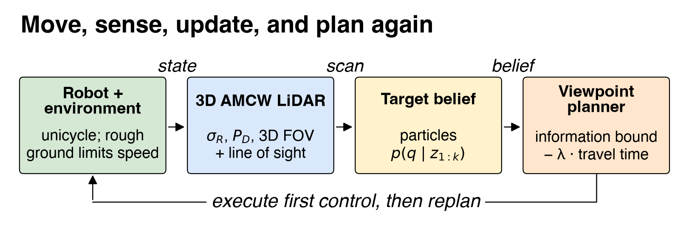
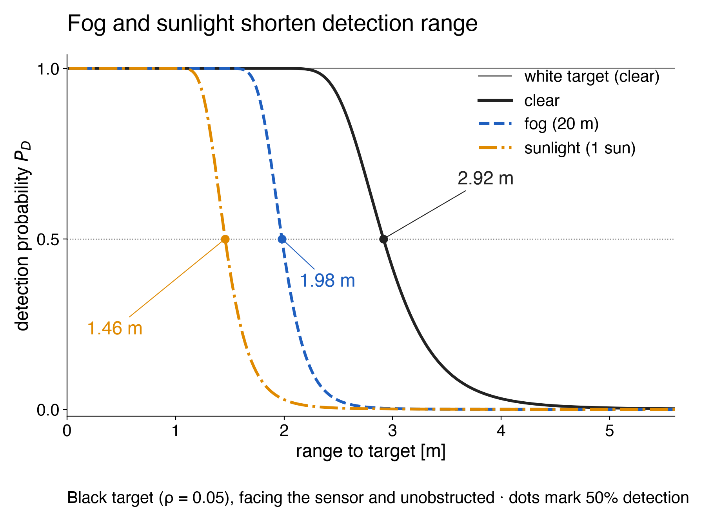
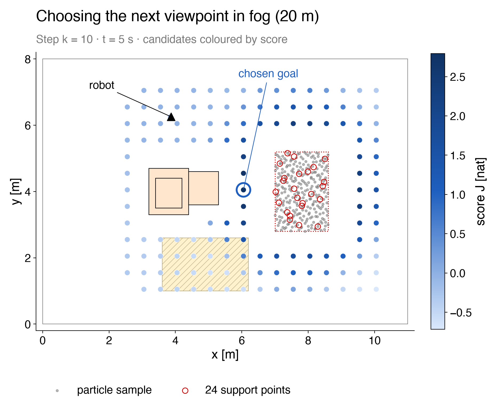
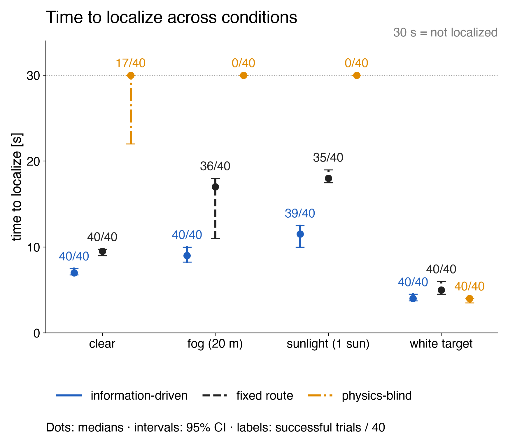
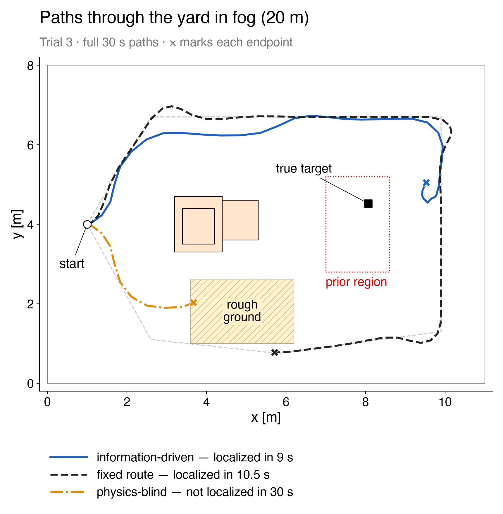
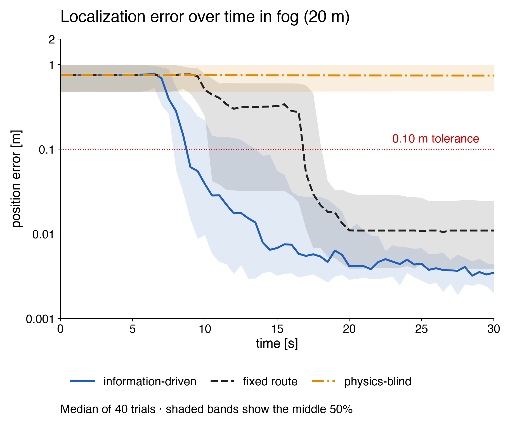
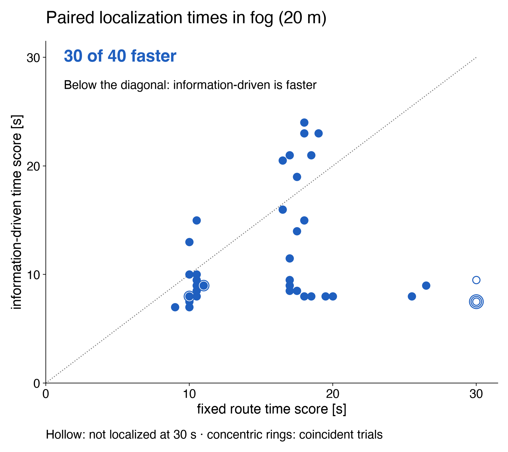

  

<h1 align="center">Move to See</h1>

  <strong>Physics-informed active perception: a robot that drives to where its LiDAR will actually see the target.</strong>

  
  
  
  
  
  
  

---

> **Try it:** the [interactive site](https://robot.josephjuniormensah.com) replays all 480 recorded trials, lets you
> change the target, the fog and the sunlight to see what the sensor model predicts, and steps through the planner's
> real choices. Its source is in [`web/`](web/).

A small rover carries an amplitude-modulated continuous-wave (AMCW) LiDAR and must find a **dark box hidden behind
crates**, in clear air, in fog and in bright sunlight. A dark target returns little light, fog attenuates it, and sunlight
buries it in noise, so a target in plain view can still be invisible to the sensor. The question this project asks is
the one from its proposal: **can knowing when a LiDAR fails help a robot localize better?**

The robot keeps a particle belief over where the target is. Every half second it predicts, with a physics-based model
of its sensor, how much each candidate viewpoint would teach it about the target, subtracts a cost for the time it takes to
drive there, and heads for the best one. It is compared trial by trial with a **fixed inspection route** and with the
**same planner using a physics-blind sensor model**. Every experiment was registered, with its hypothesis, sample size,
seed and pass criteria, before its first full run; the few later changes are documented.

This is my final project for ECE 4240 (Robot Perception) at Cornell. It builds on my midterm, a waveform-level AMCW
LiDAR simulator, which it extends to 3D and then uses for inference and planning.

## Highlights

- **Faster in every condition.** With a black target the physics-aware planner localizes it in a median **7.0 s** in
  clear air, **9.0 s** in fog and **11.5 s** in sunlight, against 9.5, 17.0 and 18.0 s for the fixed route.
- **The physics matters most when the sensor struggles.** The same planner with a physics-blind sensor model localizes
  the target in **0 of 80** fog and sunlight trials; with the physics it localizes 79 of 80.
- **A clean control.** With a white target in clear air, which the sensor detects easily, the median paired
  difference between the two planners is 0 s (95 % interval 0 to 0 s), inside the registered ±2 s margin; 30 of 40
  pairs tie exactly. That points to the sensor model, not the planner, as the source of the gain.
- **Registered before it was run.** Five one-sided paired tests, all with Holm-adjusted p ≤ 7.2 × 10⁻⁴; every verdict
  and the four documented deviations are published.
- **Verified piece by piece.** 666 fast tests, including oracle suites with independently computed reference values,
  plus registered experiments that check the sensor model, the field of view, the filter and the information bound on
  their own.

## How it works

**The robot.** A unicycle with acceleration and turn-rate limits that slows to 0.3 m/s on rough ground. It knows its
own pose and the map of the yard; only the target's position is unknown.

**The sensor.** A two-frequency AMCW LiDAR scanning 121 × 11 beams over 240° by 50°, each beam traced as nine
Gauss–Hermite sub-rays. Its ground truth is a waveform-level simulation: Lambertian returns, fog attenuation, sunlight
shot noise, phase unwrapping and a constant-false-alarm detector. The robot reasons with a separately written analytic
model of the same sensor, which predicts, for every beam, the probability of a detection and the noise on its range.

For an unobstructed target facing the sensor, a beam detects a black target (reflectivity 0.05) half the time at
2.92 m in clear air, 1.98 m in fog and 1.46 m in sunlight, while in clear air a white target is detected across the whole
5.6 m reporting window. Incidence angle and occlusion shorten these ranges further. That is why where the robot stands
matters.

**The belief.** An approximate, regularized particle filter with 2000 particles over the target's 3D position. Each scan updates it
with the analytic likelihood, which also counts what the robot did *not* see: a dark target that hides a brighter
surface behind it is informative even when it returns nothing.

**The planner.** For each candidate viewpoint on a reachable lattice, the planner computes a Bhattacharyya lower bound
on the expected information gain over 24 target hypotheses sampled from the belief, and subtracts 0.05 nat per second
of travel. It keeps its current goal unless another viewpoint beats it by 0.05 nat, and skips viewpoints too far away
to win. To stay fast, planning predicts each viewpoint with a simplified version of the sensor model: one ray per beam
from a standing robot, without mixed pixels, scan skew or phase-wrap outliers.

Five seconds into fog trial 0, the high-scoring viewpoints surround the region where the target may be, at distances
where a dark target can still be detected through the fog. The robot keeps its previous goal at (6.05, 4.05) m, which is
also the best this step: 3.09 nat of information minus 0.30 nat for 6 s of travel.

**The baselines.** The *fixed route* drives a preset inspection loop around the yard. The *physics-blind* planner is
the same planner choosing viewpoints with a sensor model that assumes every visible point within range is detected,
with constant range noise. All three controllers update their belief with the same full-physics model, so the only
difference between them is how they pick where to go. Each trial gives all three the same target position and the same
random noise, so every trial is a paired comparison.

## Results

40 paired trials per condition, 30 s each. The *time to localize* is the moment from which the belief mean stays
within 0.10 m of the true target for five consecutive scans (30 s if it never does).

| condition | information-driven | fixed route | physics-blind |
| --- | ---: | ---: | ---: |
| clear air, black target | **7.0 s** · 40/40 | 9.5 s · 40/40 | 30.0 s · 17/40 |
| fog, 20 m visibility | **9.0 s** · 40/40 | 17.0 s · 36/40 | 30.0 s · 0/40 |
| sunlight, 1 sun | **11.5 s** · 39/40 | 18.0 s · 35/40 | 30.0 s · 0/40 |
| control: white target, clear | 4.0 s · 40/40 | 5.0 s · 40/40 | 4.0 s · 40/40 |

Median time to localize · trials localized out of 40.

In this fog trial the information-driven robot drives along the top of the yard to the side of the target's region
and turns in towards it, localizing the target in 9 s; the fixed route gets there at 10.5 s. The physics-blind planner,
which expects to detect the target from much farther away than it can, stops near the rough ground and never
localizes it.

Over all 40 fog trials, the median information-driven error drops below the 0.10 m tolerance after about 9 s and
settles near 3 mm; the fixed route takes until about 17 s, and the physics-blind planner never gets there.

Trial by trial, the information-driven planner is faster than the fixed route in 30 of the 40 fog trials, ties one and
is slower in nine.

### Registered hypotheses

| hypothesis | condition | information-driven vs | median paired difference (95 % CI) | faster / tie / slower | Holm p |
| --- | --- | --- | ---: | ---: | ---: |
| H1 | clear air | fixed route | −2.5 s (−2.5 to −2.0) | 40 / 0 / 0 | 7.5 × 10⁻⁸ |
| H1 | fog | fixed route | −2.25 s (−6.5 to −1.75) | 30 / 1 / 9 | 7.2 × 10⁻⁴ |
| H1 | sunlight | fixed route | −6.5 s (−7.5 to −2.25) | 28 / 0 / 12 | 1.8 × 10⁻⁴ |
| H2 | fog | physics-blind | −21.0 s (−21.75 to −20.0) | 40 / 0 / 0 | 7.5 × 10⁻⁸ |
| H2 | sunlight | physics-blind | −18.5 s (−20.0 to −17.5) | 39 / 1 / 0 | 7.5 × 10⁻⁸ |

One-sided paired Wilcoxon signed-rank tests with Holm adjustment over the five tests, registered at α = 0.01; all
supported. **H3**, the control: with a white target in clear air, the median paired difference between the
information-driven and physics-blind planners is 0 s, with a 95 % bootstrap interval from 0 to 0 s, inside the
registered ±2 s equivalence margin.

## Verification

Each experiment's hypothesis, sample size, seed and pass criteria were written into
[`sim/registry.yaml`](sim/registry.yaml) before its first full run, and tuning used reserved pilot seeds only. Four
changes made afterwards, including one added check for the animations, are listed as deviations in the
[verification plan](docs/verification/vv-plan.md).

| ID | experiment | outcome |
| --- | --- | --- |
| F01 | 3D measurement model against the waveform simulation: 60 cells × 4000 scans | supported |
| F02 | field of view in 3D and its dependence on the robot's motion | supported |
| F03 | particle-filter coverage on the fixed route: at least 80 % of trials inside the nominal 90 % region in clear air | supported |
| F04 | information bound against a Monte Carlo estimate of the mutual information: holds in all 120 cases | supported |
| F05 | main comparison of the three controllers, H1 to H3 | supported |
| F06 | paired ablations | exploratory |
| M01 | animations of one fog trial per controller | supported |

Every verdict is written up in [`docs/verification/results.md`](docs/verification/results.md).

- **666 fast tests:** unit tests, oracle suites whose reference values come from hand calculation, brute force,
  numerical integration or grid Bayes rather than from the production code, property tests and contract tests.
- **Independent checks:** each module's oracle tests are written from the specification, separately from its
  implementation, and the analytic sensor model never imports the waveform simulator it is checked against.
- **No peeking:** inference and planning never see the true target. This is checked structurally and with a
  metamorphic test that changes the hidden target while keeping the observations fixed.
- **Reproducible:** every experiment has a fixed seed and records the source fingerprint and package versions. Deleting
  all outputs and rerunning every experiment with those versions reproduced every reported number; only the recorded
  computation times changed.

---

Joseph Junior Mensah · <a href="https://josephjuniormensah.com">josephjuniormensah.com</a>

