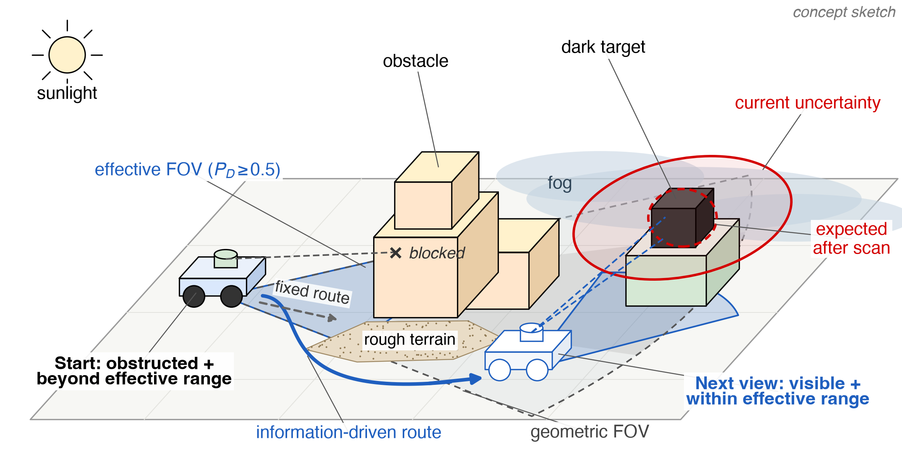

  

<h1 align="center">Move to See</h1>

  <strong>Physics-informed active perception: a robot that drives to where its LiDAR will actually see the target.</strong>

  
  
  
  
  
  
  

---

> **Try it:** the [interactive site](https://robot.josephjuniormensah.com) replays all 480 recorded trials, lets you
> change the target, the fog and the sunlight to see what the sensor model predicts, and steps through the planner's
> real choices. Its source is in [`web/`](web/).

A small rover carries an amplitude-modulated continuous-wave (AMCW) LiDAR and must find a **dark box hidden behind
crates**, in clear air, in fog and in bright sunlight. A dark target returns little light, fog attenuates it, and sunlight
buries it in noise, so a target in plain view can still be invisible to the sensor. The question this project asks is
the one from its proposal: **can knowing when a LiDAR fails help a robot localize better?**

The robot keeps a particle belief over where the target is. Every half second it predicts, with a physics-based model
of its sensor, how much each candidate viewpoint would teach it about the target, subtracts a cost for the time it takes to
drive there, and heads for the best one. It is compared trial by trial with a **fixed inspection route** and with the
**same planner using a physics-blind sensor model**. Every experiment was registered, with its hypothesis, sample size,
seed and pass criteria, before its first full run; the few later changes are documented.

This is my final project for ECE 4240 (Robot Perception) at Cornell. It builds on my midterm, a waveform-level AMCW
LiDAR simulator, which it extends to 3D and then uses for inference and planning.

---

Joseph Junior Mensah · <a href="https://josephjuniormensah.com">josephjuniormensah.com</a>

